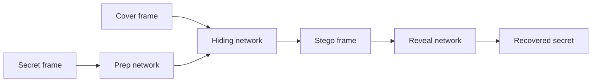

<h1 align="center">🎬 Video-in-Video Steganography · Deep Learning</h1>

A convolutional autoencoder hides an entire video — and its audio — inside another video, then reveals it.

  
  
  

> Final-year engineering project. **Code, trained weights and data aren't in this repo.** This page
> documents the method and results. [Details →](#status--known-issues)

## Why

Image and audio steganography can only hide a little data before quality suffers. Video has far more
capacity, so a learned encoder can hide a whole video in another one.

## Approach

| | Video | Audio |
|---|---|---|
| **Data** | 644 cover + 644 secret clips, 15 s at 30 fps → 300 frames each (≈ 386 k frames) | Self-recorded 10 s mono clips, 80/10/10 split |
| **Pre-processing** | 224 × 224 frames, normalised | Stereo → mono, trim/pad to cover length |
| **Model** | Prep → hide → reveal CNN autoencoder | Encode → conceal (3×3 convs) → decode |
| **Result** | Reveal accuracy **> 95 %** on validation; hiding loss falls more slowly | Converges, with training and validation curves close |

<table>
  <tr>
    <td width="50%"> Video model architecture</td>
    <td width="50%"> Audio model architecture</td>
  </tr>
  <tr>
    <td> Training vs validation</td>
    <td> Audio result</td>
  </tr>
</table>

<b>Encoder / decoder flowcharts and accuracy curve</b>

 

**Hardware used:** RTX 3050-class GPU, 16 GB RAM, 512 GB SSD.

## Status & known issues

| Issue | Effect |
|---|---|
| **No code, weights or dataset in the repo** | Results can't be reproduced |
| "Accuracy" used for a reconstruction task | PSNR and SSIM are the standard metrics and should be reported |
| Frame-by-frame hiding | No temporal consistency, so possible flicker between frames |
| No compression test | H.264 re-encoding may destroy the hidden video |
| GUI mentioned but not shown | The section is empty |

## Roadmap

- [ ] Publish the training/inference notebook and a small sample set
- [ ] Report PSNR and SSIM for stego and revealed frames
- [ ] Test robustness to H.264; add a temporal (3D-conv) model
